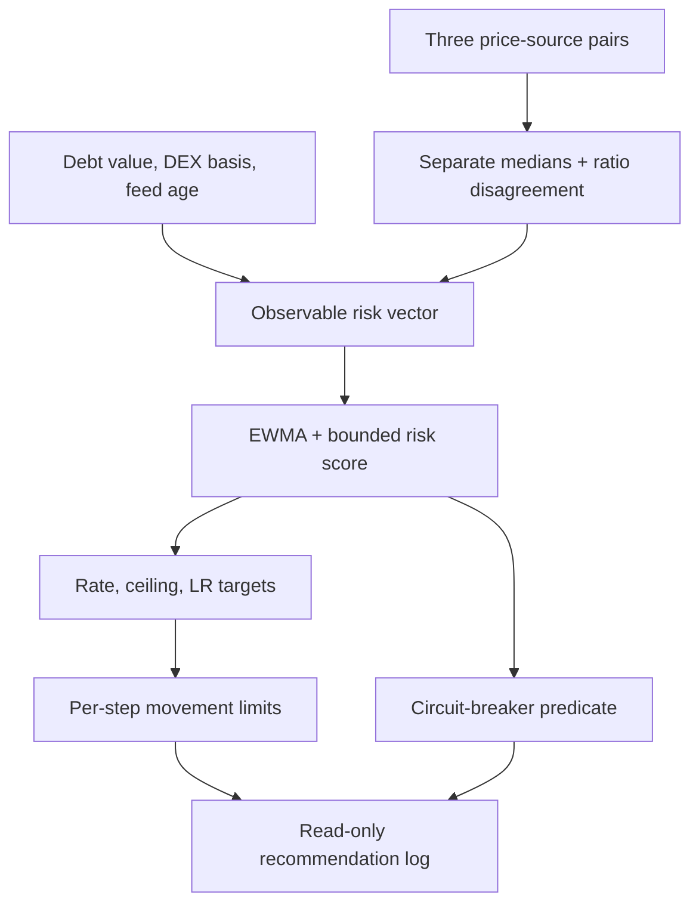

# Read-only shadow mode

## Purpose and safety boundary

Shadow mode runs the Section 5 controller beside a protocol or historical data
set. It computes recommendations but cannot apply them. The implementation has
no private-key input, signer, transaction builder, `eth_sendTransaction`, or
`eth_sendRawTransaction` path. The optional JSON-RPC helper has an explicit
allow-list limited to `eth_call`, block reads, and chain identification.

This is an observability and validation tool, not a production deployment or a
claim that the heuristic controller has been formally proved safe.

## Data and control flow



The observation vector at step \(t\) is

\[
x_t=(P^{L}_{O,t},P^{E}_{O,t},P^{L}_{D,t},P^{E}_{D,t},
P^{L}_{R,t},P^{E}_{R,t},b_t,D_t,a_t),
\]

where \(L\) is the local-currency leg, \(E\) is the ETH leg, \(O,D,R\)
denote official, DEX, and reference sources, \(b_t\) is DEX basis, \(D_t\)
is observed debt value, and \(a_t\) is oracle age.

The robust price pair and disagreement are

\[
\widehat P^L_t=\operatorname{median}_j P^L_{j,t},\qquad
\widehat P^E_t=\operatorname{median}_j P^E_{j,t},
\]

\[
\delta_t=\max_j\log(P^E_{j,t}/P^L_{j,t})-
\min_j\log(P^E_{j,t}/P^L_{j,t}).
\]

For live observations, \(q_t=\log((\widehat P^E_t/\widehat P^L_t)/
(\widehat P^E_{t-1}/\widehat P^L_{t-1}))\). A replay may supply
`ratio_log_return` explicitly. The state equations are

\[
v_{t+1}=0.92v_t+0.08q_t^2,\quad \sigma_t=\sqrt{v_{t+1}},\quad
u_t=D_t/C_t,
\]

\[
R_t=\operatorname{clip}_{[0,1]}\!\left(
4\sigma_t+3.2b_t+1.8\delta_t+0.9(u_t-0.72)_+
\right).
\]

Targets are

\[
r_t^*=\operatorname{clip}_{[0.04,1.50]}
\left(0.08+0.90R_t+0.35(u_t-0.75)_+\right),
\]

\[
C_t^*=\operatorname{clip}_{[0.20,1.00]}\left(e^{-1.75R_t}\right),
\qquad
\lambda_t^*=\operatorname{clip}_{[1.50,2.20]}(1.50+0.70R_t).
\]

The recommended next state is rate-limited:

\[
r_{t+1}=r_t+\operatorname{clip}_{[-0.02,0.05]}(r_t^*-r_t),
\]

\[
C_{t+1}=C_t+\operatorname{clip}_{[-0.05,0.02]}(C_t^*-C_t),
\quad
\lambda_{t+1}=\lambda_t+
\operatorname{clip}_{[-0.02,0.035]}(\lambda_t^*-\lambda_t).
\]

New draws are recommended paused when

\[
b_t>0.065\;\lor\;\delta_t>0.14\;\lor\;\sigma_t>0.10
\;\lor\;a_t>36\text{ hours},
\]

with a four-step cooldown. Repayment and collateral top-up are outside this
pause recommendation.

## Run a historical replay

From the repository root:

```bash
python3 analysis/run_shadow.py --config config/shadow.replay.example.json
```

The command writes one JSON object per observation to
`results/shadow_decisions.jsonl`. Each object contains the raw derived inputs,
four risk components, unclipped targets, rate-limited recommendations, baseline
(previous-state) parameters, breaker status, formula version, and a SHA-256 hash
of the controller configuration.

## Connect an observer endpoint

Copy `config/shadow.http.example.json`, replace the deliberately invalid URL,
and map the endpoint's JSON paths. Use `mode: once` during integration. Only
after validating the log should `mode: live` be used. Live mode defaults to a
six-hour poll interval; `max_iterations: 0` means run until interrupted.

```bash
python3 analysis/run_shadow.py --config config/my-shadow.json --mode once
python3 analysis/run_shadow.py --config config/my-shadow.json --mode live --max-iterations 8
```

HTTP headers can be configured for a read-only endpoint, but secrets should be
injected by the surrounding process rather than committed. The runner never
prints configured headers.

## Interpretation

The `baseline_*` fields are the parameters that would remain in force before
the observation; `recommended_*` are the isolated counterfactual values. This
supports decision-level comparison. Economic outcome comparison (bad debt,
liquidations, issuance) still requires replaying the recommendation sequence in
the repository's simulation model.

The live volatility proxy uses robust observed oracle returns because true
contemporaneous prices are unavailable in production. The paper simulation can
use latent true path returns for controlled experiments. This difference is
intentional and is recorded through `formula_version` and the input log.
